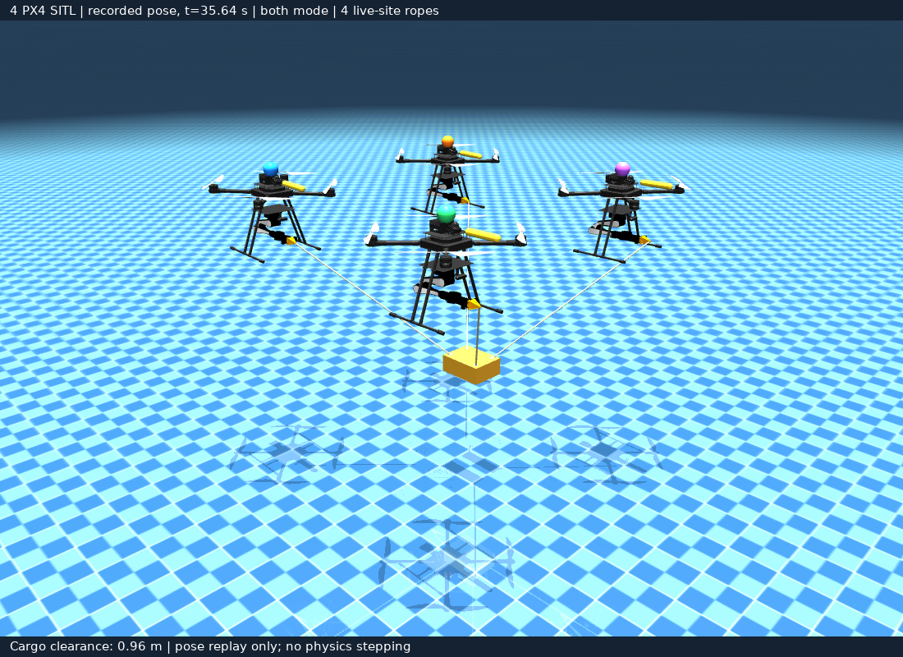

# Wind_disturbance_simulation_part2

**English** | [简体中文](README.zh-CN.md)

Multi-UAV wind interaction simulation in MuJoCo with multiple PX4 SITL instances, artificial disturbance visualization, and cooperative payload transport.

Four X4-950 aircraft with Airbot Play arms share one MuJoCo world, with independent XYZ control and four ropes carrying one payload. Interaction uses a **manually specified distance-decaying acceleration disturbance model**; surfaces illustrate artificial strength. PX4 uses simulation truth-state feedback.

## Demo

https://github.com/user-attachments/assets/9a2315fe-3065-4619-844e-3c66ddbbb3b2

[Download MP4](demo/Demo%20video.mp4)

<table>
  <tr>
    <td width="50%" align="center" valign="top">
      <a href="demo/Mujoco%20model.png"> Four-UAV MuJoCo scene</a>
    </td>
    <td width="50%" align="center" valign="top">
      <a href="demo/Contorl%20UI.png"> Independent controls for four UAVs</a>
    </td>
  </tr>
  <tr>
    <td width="50%" align="center" valign="top">
      <a href="docs/media/four-uav-fields/disturbance-surface-close.png"> Four-source surface illustration</a>
    </td>
    <td width="50%" align="center" valign="top">
      <a href="docs/media/four-uav-payload-sitl.png"> Verified payload pose replay</a>
    </td>
  </tr>
</table>

## Features

- Four independent PX4 SITL processes using one bundled binary.
- Four aircraft facing +X, with shared takeoff/landing and individual XYZ targets.
- Four-rope cooperative payload transport.
- Adjustable horizontal/downward disturbances and four strength surfaces.
- Automated takeoff, lift, translation and landing sequence.

## Project structure

~~~text
Wind_disturbance_simulation_part2/
├── src/
│   ├── dual_uav_interaction/
│   │   ├── simulation.py       # Shared MuJoCo world and simulation loop
│   │   ├── fleet.py            # Two/four-aircraft configuration
│   │   ├── px4_bridge.py       # Per-aircraft PX4 communication
│   │   ├── interaction.py      # Artificial disturbance forces
│   │   ├── disturbance_visualization.py  # Strength surfaces
│   │   ├── payload.py          # Elastic ropes and shared payload
│   │   ├── panel.py            # Independent aircraft controls
│   │   └── assets/             # MuJoCo models and assets
│   │       ├── scenes/default/
│   │       │   └── robot_quadrotor_950_with_arm.xml
│   │       ├── robot_models/
│   │       │   ├── quadrotor_950/
│   │       │   │   ├── quadrotor_950.xml
│   │       │   │   └── meshes/
│   │       │   ├── airbot_play/
│   │       │   │   ├── airbot_play.xml
│   │       │   │   └── meshes/
│   │       │   └── scenes/
│   │       │       └── ground.xml
│   │       └── configs/         # PX4 parameters
│   └── pymavlink/              # Bundled MAVLink library
├── runtime/px4/                # Prebuilt PX4 SITL
├── scripts/                    # Launch, preview and validation tools
├── tests/                      # Offline checks
├── demo/                       # Screenshots and video
├── docs/                       # Installation and validation records
├── licenses/                   # Third-party licenses
├── pyproject.toml
└── requirements.txt
~~~

MuJoCo scene entry: [robot_quadrotor_950_with_arm.xml](src/dual_uav_interaction/assets/scenes/default/robot_quadrotor_950_with_arm.xml). [scene.py](src/dual_uav_interaction/scene.py) assembles the shared four-aircraft world, payload and ropes at runtime.

## Installation and launch

Tested on **Ubuntu 24.04 x86-64 / Python 3.12**, with MuJoCo 3.6.0, NumPy 2.4.4 and Matplotlib 3.10.9. The GUI requires Tk and OpenGL; MAVLink dependencies are supplied or installed through requirements.

The bundled PX4 needs Gazebo Transport 13, Messages 10, Utils 2 and Protobuf 32 libraries. See the [installation guide](docs/INSTALLATION.md) (Chinese); resolve every “not found” entry from **ldd**.

~~~bash
git clone https://github.com/Chenghao-Huang1218/Wind_disturbance_simulation_part2.git
cd Wind_disturbance_simulation_part2
conda create -n env_uav python=3.12 -y
conda activate env_uav
python -m pip install -r requirements.txt
ldd runtime/px4/bin/px4

# Model/configuration check
python scripts/run_simulation.py --check --mode both

# Four PX4 instances, MuJoCo and control panel
python scripts/run_simulation.py --aircraft-count 4 --mode both --instance-base 4
~~~

No separate PX4 terminal or firmware build is needed. The command above enables both disturbance channels; the CLI default is **off**.

## Control panel

1. Wait for all four aircraft to show **connected**, then click **Takeoff all**.
2. Wait for the payload to lift, then use each aircraft's XYZ buttons.
3. Click **Start wind field / Stop wind field** to toggle the surfaces.
4. Click **Land all**, wait for landing/disarming, then **Exit**.

| Control | Function |
| --- | --- |
| A/B/C/D: X±, Y±, Z± | Change only that aircraft's world-frame target; +Z is up |
| Step: 0.10 / 0.20 / 0.50 | Shared position increment in m; default 0.20 |
| off / horizontal / vertical / both | Disturbance channels; click Apply to activate |
| Ah / Az / L + Apply | Apply amplitudes and decay length |
| Start / Stop wind field | Surface display only; force settings stay active |
| Pos / Tgt, Distance, Cargo, Rope | Position/target, minimum spacing, payload height, tensions |
| Emergency | Stop simulated rotors and request disarming |
| Exit | Close and clean up this launcher's PX4 processes |

A/B are above C/D. Minimum horizontal target spacing is **1.5 m**; loaded targets must also fit the rope geometry. Loaded target speed is limited to **0.25 m/s**. Use **--panel-hz 0.5** for slower readout refresh.

## Model

The shared world advances once per **0.005 s** physics step. Aircraft begin in a 2 m square with the same heading; each aircraft and arm weighs about 8.0004 kg.

### Artificial distance-decaying acceleration disturbance

For receiver $i$ and source $j$, horizontal distance and direction are:

$$
d_{ij}=\sqrt{(x_i-x_j)^2+(y_i-y_j)^2},
\qquad
 g_{ij}=\frac{1}{1+(d_{ij}/L)^2}
$$

$$
\mathbf e_{j\to i}=\frac{\mathbf p_{i,xy}-\mathbf p_{j,xy}}{d_{ij}}
$$

Contributions from other active sources $\mathcal S_i$ are summed:

$$
\begin{aligned}
\mathbf a_{i,xy}&=\sum_{j\in\mathcal S_i} A_h g_{ij}\,\mathbf e_{j\to i},\\
a_{i,z}&=-\sum_{j\in\mathcal S_i} A_z g_{ij},\\
\mathbf F_i&=m_i\mathbf a_i.
\end{aligned}
$$

| Parameter | Meaning | Default |
| --- | --- | --- |
| Ah | Per-source outward horizontal acceleration | 0.5 m/s² |
| Az | Per-source downward acceleration | 0.5 m/s² |
| L | Half-strength horizontal distance | 2 m |

Sources must be airborne with rotor thrust; receivers must be airborne. Forces are distributed by body mass at body centers of mass. Channels follow the selected mode; **off** clears disturbance forces.

### Strength surfaces

Four translucent surfaces and contours follow the aircraft below their horizontal planes:

$$
g(r)=\frac{1}{1+(r/L)^2}
$$

$$
z_{\mathrm{vis},i}(r)=z_i-0.05-1.35\bigl[1-g(r)\bigr],
\qquad 0\le r\le 10\,\mathrm{m}
$$

The peak is 0.05 m below the aircraft origin. The 10 m radius limits visualization only.

### Shared payload

Four elastic ropes connect the Airbot Play grippers to four top attachment points on a **0.5 kg, 0.40×0.30×0.15 m** box. Defaults: $L_0=1.6$ m, $k=100$ N/m, $c=3$ N·s/m.

$$
\mathbf r=\mathbf p_{\mathrm{box,site}}-\mathbf p_{\mathrm{gripper}},
\qquad \ell=\lVert\mathbf r\rVert,
\qquad \mathbf n=\frac{\mathbf r}{\ell}
$$

$$
\dot\ell=\bigl(\mathbf v_{\mathrm{box,site}}-\mathbf v_{\mathrm{gripper}}\bigr)\cdot\mathbf n
$$

$$
T=\begin{cases}
\max(0, k(\ell-L_0)+c\dot{\ell}), & \ell>L_0,\\
0, & \ell\le L_0.
\end{cases}
$$

$$
\mathbf F_{\mathrm{gripper}}=T\mathbf n,
\qquad \mathbf F_{\mathrm{box}}=-T\mathbf n
$$

Here $\mathbf n$ points from gripper to payload attachment. Site Jacobians provide attachment velocities; **mj_applyFT** applies equal and opposite point forces and their moments.

## Other run modes

~~~bash
# No payload
python scripts/run_simulation.py --no-payload --mode both --instance-base 4

# Two-aircraft mode
python scripts/run_simulation.py --aircraft-count 2 --mode both --instance-base 4

# Headless automatic transport
python scripts/run_simulation.py --headless --auto --mode both --duration 3 --timeout 300 --instance-base 4

# All options
python scripts/run_simulation.py --help
~~~
