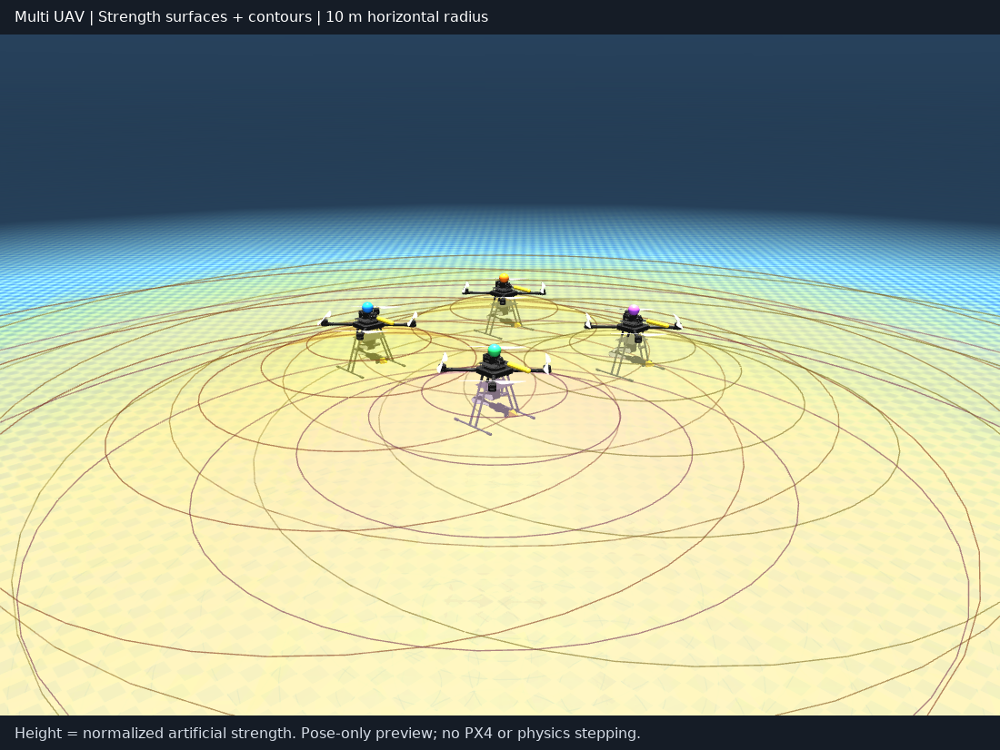

# Wind_disturbance_simulation_part2

[简体中文](README.md) | **English**

**Multi-UAV wind interaction and cooperative payload transport · MuJoCo + multiple PX4 SITL**

This project runs **four X4-950 quadrotors, each carrying an Airbot Play manipulator**, in a shared MuJoCo world by default.
Each aircraft has its own PX4 SITL process and independent XYZ position controls.
Four elastic ropes connect the gripper endpoints to a shared payload, and each aircraft has its own disturbance-strength surface.

The platform supports multi-UAV interaction, payload transport, control-interface testing, and comparisons with artificial disturbances.
It currently uses a **manually specified distance-decaying acceleration disturbance model**, rather than an experimentally calibrated wake model.
The displayed surfaces do not represent actual wind velocity or physical potential energy.
PX4 receives simulation truth feedback; this does not validate real-sensor estimation or real flight.

## Four-UAV demo

https://github.com/user-attachments/assets/9a2315fe-3065-4619-844e-3c66ddbbb3b2

[Download the original demo video](demo/Demo%20video.mp4).

<table>
  <tr>
    <td width="50%" align="center" valign="top">
      <a href="demo/Mujoco%20model.png"><br>Four-UAV MuJoCo scene</a>
    </td>
    <td width="50%" align="center" valign="top">
      <a href="demo/Contorl%20UI.png"><br>Independent controls for four UAVs</a>
    </td>
  </tr>
  <tr>
    <td width="50%" align="center" valign="top">
      <a href="docs/media/four-uav-fields/disturbance-surface-close.png"><br>Four-source surface illustration</a>
    </td>
    <td width="50%" align="center" valign="top">
      <a href="docs/media/four-uav-payload-sitl.png"><br>Verified payload pose replay</a>
    </td>
  </tr>
</table>

## Features and applications

- **Shared physics world:** four complete UAV/manipulator assemblies, common ground, contacts, and payload dynamics; MuJoCo advances exactly once per physics step.
- **Four independent flight controllers:** four instances of the same precompiled PX4 SITL executable, with isolated identities, ports, parameters, and logs.
- **Independent aircraft controls:** collective takeoff/landing and separate world-frame XYZ position targets for each aircraft.
- **Cooperative transport:** four aircraft face the same direction, with four elastic ropes linking their gripper endpoints to four separate attachment sites on the payload top.
- **Adjustable artificial interaction:** off, horizontal, vertical, and combined modes, with runtime amplitude and decay-length controls.
- **Disturbance visualization:** four translucent strength surfaces with contours, each following its aircraft below the aircraft's horizontal plane, with a 10 m horizontal display radius.
- **Automatic sequence and logging:** takeoff, lift, common translation, hold, landing, and exit; records aircraft states, four rope tensions, interaction accelerations, and real-time factor.

The manipulators hold their initial poses, and the ropes are connected before takeoff.

## Requirements

The validated platform is **Ubuntu 24.04, Linux x86-64, and Python 3.12**.
Windows, macOS, ARM, and other Linux distributions have not been validated.

| Category | Requirements |
| --- | --- |
| Simulation and numerical computing | MuJoCo 3.6.0, NumPy 2.4.4 |
| Control panel | Matplotlib 3.10.9, Tk/Tkinter, a desktop display, and working OpenGL drivers |
| Communication | Bundled pymavlink 2.4.47, plus lxml and pyserial |
| Flight control | Bundled Linux x86-64 PX4 SITL runtime; no separate PX4 download or build is required |
| PX4 system libraries | Gazebo Transport 13, Messages 10, Utils 2, Protobuf 32, and their transitive dependencies; provided by ROS Jazzy vendor packages on the validated host |
| Offline tests | pytest ≥ 8 |

**Installing Python packages does not install PX4's system libraries.**
See the [installation guide](docs/INSTALLATION.md) (Chinese) for detailed setup, library checks, and troubleshooting.
MuJoCo computes the simulation physics; Gazebo vendor packages only supply libraries linked by the existing PX4 executable.

## Installation and startup

Run the following commands from the cloned repository. No other project directory on the developer's machine is required.

```bash
git clone https://github.com/Chenghao-Huang1218/Wind_disturbance_simulation_part2.git
cd Wind_disturbance_simulation_part2

conda create -n env_uav python=3.12 -y
conda activate env_uav
python -m pip install -r requirements.txt

# There must be no "not found" entries; see docs/INSTALLATION.md
ldd runtime/px4/bin/px4

# Load the model/configuration only: no PX4, windows, or network
python scripts/run_simulation.py --check --mode both

# Start four PX4 instances, the MuJoCo viewer, and the compact control panel
python scripts/run_simulation.py --aircraft-count 4 --mode both --instance-base 4
```

No separate PX4 terminal task is needed. The launcher manages only its own four child processes.
If required ports are occupied, it reports an error without stopping other sessions.
The CLI interaction mode defaults to `off`; the command above explicitly enables `both`.

With an existing environment:

```bash
conda activate env_uav
cd Wind_disturbance_simulation_part2  # Replace with your actual project path
python scripts/run_simulation.py --aircraft-count 4 --mode both --instance-base 4
```

## Using the control panel

The four-aircraft panel is approximately 900×640, subject to DPI scaling.
A/B occupy the top row and C/D the bottom row in a compact 2×2 layout.

1. Wait until all four aircraft show **connected**.
2. Click **Takeoff all**. The button shows **Arming all...** until all four aircraft confirm that they are armed, then takeoff begins.
3. Wait for the aircraft to climb, the ropes to become taut, and the payload to lift; then use each aircraft's XYZ controls.
4. Click **Start wind field** to show the surfaces, and **Stop wind field** to hide them.
5. Click **Land all**, wait until all four aircraft have landed and disarmed, then click **Exit**.

| Control | Function |
| --- | --- |
| A/B/C/D X+/X− | Changes only the selected aircraft's world X target; blue |
| A/B/C/D Y+/Y− | Changes only the selected aircraft's world Y target; green |
| A/B/C/D Z+/Z− | Changes only the selected aircraft's world Z target; orange; +Z is upward |
| Step: 0.10 / 0.20 / 0.50 | Shared displacement increment in metres; default 0.20 m |
| Takeoff all / Land all | Collective takeoff / landing |
| Emergency | Immediately stops simulated rotors and requests disarming; does not perform a controlled landing |
| Exit | Exits and cleans up this launcher's four PX4 processes; Ctrl+C follows the same cleanup path |
| Start wind field / Stop wind field | Toggles surface visibility only; does not change interaction or rope forces |
| off / horizontal / vertical / both | Draft interaction mode; takes effect after Apply |
| Ah / Az / L and Apply | Validates and applies the mode and all three parameters together; invalid input preserves the previous valid settings |
| Pos / Tgt, Distance, Cargo, Rope A/B/C/D | Current/final target positions, minimum horizontal aircraft separation, payload centre height, and four rope tensions |

A direction click changes only the selected aircraft's target; the other three targets remain unchanged.
The aircraft remain physically coupled through the ropes and payload.
Only armed aircraft in takeoff or hover accept directional commands.
Every pair of aircraft targets must have at least **1.50 m** horizontal separation.
In four-aircraft loaded mode, each projected gripper-to-payload-site horizontal span must also be shorter than the rope length.
In unloaded mode, pairwise target separation must not exceed **10 m**.
A rejected command leaves all targets unchanged.
These are target-setting constraints, not real-flight safety validation or a guarantee of rope stability under arbitrary height differences and dynamic attitudes.
The original two-aircraft loaded mode retains its **1.50–2.25 m** horizontal target-separation range.

Loaded position setpoints are smoothed in simulation time, with a speed limit of **0.25 m/s** and nominal acceleration slew of **0.1 m/s²**.

## Implementation

### Shared world and four PX4 instances

The four assemblies use the `a/`, `b/`, `c/`, and `d/` namespaces and share one MuJoCo world with a 0.005 s physics timestep.
Each step refreshes a common-time snapshot, computes contributions from all other active sources and all four rope forces,
exchanges states/actuator data with each PX4, and advances physics once.
PX4 retains its native control loops. The existing simulation-truth feedback adaptation bypasses the real-sensor EKF2 estimation chain.

The initial formation is a square with a 2 m side:
A=(-1,-1), B=(-1,+1), C=(+1,-1), D=(+1,+1) m.
All aircraft face +X, with an initial root height of 0.48 m.
Each aircraft/manipulator assembly has a mass of approximately 8.0004 kg.
Four processes run the same PX4 executable, one per aircraft.

### Manually specified distance-decaying acceleration disturbance model

For receiver $i$ and another source $j$, let $d_{ij}$ be their horizontal distance and $\mathbf e_{j\to i}$ the horizontal unit vector from source to receiver:

$$
d_{ij}=\sqrt{(x_i-x_j)^2+(y_i-y_j)^2},
\qquad
 g_{ij}=\frac{1}{1+(d_{ij}/L)^2}
$$

$$
\mathbf e_{j\to i}=\frac{\mathbf p_{i,xy}-\mathbf p_{j,xy}}{d_{ij}}
$$

Let $\mathcal S_i$ contain all other source aircraft that satisfy the flight-phase and thrust conditions.
With both disturbance channels enabled:

$$
\begin{aligned}
\mathbf a_{i,xy}&=\sum_{j\in\mathcal S_i} A_h g_{ij}\,\mathbf e_{j\to i},\\
a_{i,z}&=-\sum_{j\in\mathcal S_i} A_z g_{ij},\\
\mathbf F_i&=m_i\mathbf a_i.
\end{aligned}
$$

Each aircraft sums the contributions of the other three active sources, excluding itself.
The original two-aircraft mode has only one other source.

| Parameter | Meaning | Default |
| --- | --- | --- |
| Ah | Peak outward horizontal acceleration per source | 0.5 m/s² |
| Az | Peak downward acceleration per source | 0.5 m/s² |
| L | Horizontal distance at which strength falls to half its peak | 2 m |

Disabled channels contribute zero, and `off` clears existing interaction loads.
Sources must be airborne in a flight phase and produce actual simulated rotor thrust; receivers must also satisfy flight-phase and height conditions.
Contributions are not averaged by source count, so the total disturbance can exceed the two-aircraft case for the same Ah/Az.
The model uses horizontal distance and does not include height difference, attitude, or rotor-speed-dependent wake terms.

Each body receives $\mathbf F_b=m_b\mathbf a_i$ at its centre of mass.
The total force is $m_i\mathbf a_i$, with zero interaction moment about the current complete-aircraft centre of mass.
Rope attachment-point moments are computed separately.

For horizontal radius $r$ around a source, the displayed surface is:

$$
g(r)=\frac{1}{1+(r/L)^2}
$$

$$
z_{\mathrm{vis},i}(r)=z_i-0.05-1.35\bigl[1-g(r)\bigr],
\qquad 0\le r\le 10\,\mathrm{m}
$$

The surface peak is 0.05 m below the aircraft root, and its outer edge fades out.
After a source stops, its surface fades over 0.6 s of simulation time.
The 10 m radius limits visualization only; it does not truncate the force model's decay tail.

### Four elastic ropes and a shared payload

The default payload is a free rigid box of **0.5 kg and 0.40×0.30×0.15 m**.
Four initially slack ropes connect the actual Airbot Play `link6/endpoint` sites to four independent sites on the payload top.
The local payload attachment coordinates are `(-.15,-.10,.075)`, `(-.15,+.10,.075)`,
`(+.15,-.10,.075)`, and `(+.15,+.10,.075)` m, respectively.
The four-aircraft defaults are `L0=1.6 m`, `k=100 N/m`, and `c=3 N·s/m`.

$$
\mathbf r=\mathbf p_{\mathrm{box,site}}-\mathbf p_{\mathrm{gripper}},
\qquad \ell=\lVert\mathbf r\rVert,
\qquad \mathbf n=\frac{\mathbf r}{\ell}
$$

$$
\dot\ell=\bigl(\mathbf v_{\mathrm{box,site}}-\mathbf v_{\mathrm{gripper}}\bigr)\cdot\mathbf n
$$

$$
T=\begin{cases}
\max\left\{0,\;k(\ell-L_0)+c\dot\ell\right\}, & \ell>L_0,\\
0, & \ell\le L_0.
\end{cases}
$$

$$
\mathbf F_{\mathrm{gripper}}=T\mathbf n,
\qquad \mathbf F_{\mathrm{box}}=-T\mathbf n
$$

Force is zero at zero rope length.
Attachment-point velocities are computed from the actual site Jacobians, and equal/opposite point loads are applied with `mj_applyFT`,
retaining moments on the manipulators, aircraft, and payload.
Visible ropes are drawing only and do not apply duplicate forces.
This is a unilateral spring-damper model without sag, collision, rupture, or active winching; its parameters have not been calibrated to a physical rope material.

## Other run modes

```bash
# Four aircraft without payload or ropes
python scripts/run_simulation.py --no-payload --mode both --instance-base 4

# Original two-aircraft mode: default rope length 1.2 m, button labels use "both"
python scripts/run_simulation.py --aircraft-count 2 --mode both --instance-base 4

# Set interaction parameters
python scripts/run_simulation.py --mode both --horizontal 0.5 --vertical 0.5 --length 2 --instance-base 4

# Complete headless transport sequence; timeout and duration are wall-clock seconds
python scripts/run_simulation.py --headless --auto --mode both --duration 3 --timeout 300 --instance-base 4

# Lower numeric readout rate without reducing input, physics, or field update rates
python scripts/run_simulation.py --mode both --instance-base 4 --panel-hz 0.5

# List all arguments
python scripts/run_simulation.py --help

# Offline tests: no PX4 processes
python -m pip install 'pytest>=8'
PYTEST_DISABLE_PLUGIN_AUTOLOAD=1 MPLBACKEND=Agg python -m pytest -q
```

The automatic sequence checks measured states: takeoff → sustained payload clearance, rope tension, velocity, and aircraft position conditions →
common +X translation of 0.5 m → measured payload displacement and settling → hold →
landing, payload ground contact, slack ropes, and all four aircraft disarmed.
Slower hosts may hit the wall-clock timeout. The 300 s example does not change the default 80 s timeout or acceptance conditions.
