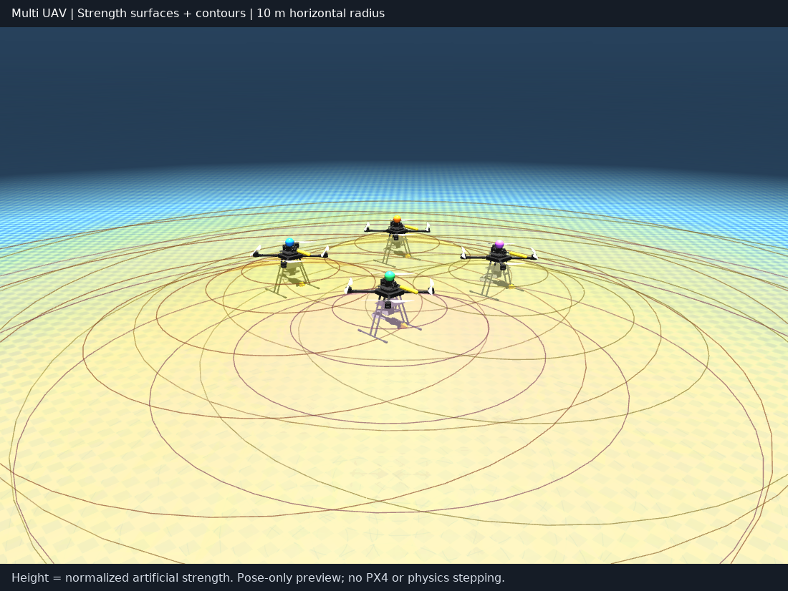
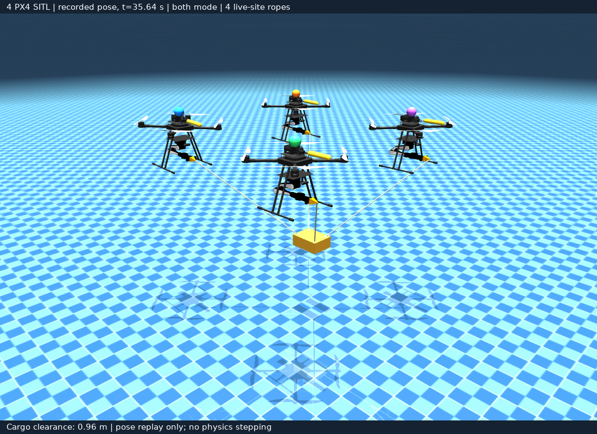

# Wind_disturbance_simulation_part2

[English](README.md) | **简体中文**

基于 MuJoCo 与多 PX4 SITL 的多无人机风场互扰仿真，支持人工扰动可视化与协同吊运。

四架搭载 Airbot Play 机械臂的 X4-950 共享物理世界，支持独立 XYZ 控制与四绳共吊一个物块。互扰采用 **“人工设置的距离衰减加速度扰动模型”**，曲面显示人工强度；PX4 使用仿真真值反馈。

## 演示

https://github.com/user-attachments/assets/9a2315fe-3065-4619-844e-3c66ddbbb3b2

[下载 MP4](demo/Demo%20video.mp4)

<table>
  <tr>
    <td width="50%" align="center" valign="top">
      <a href="demo/Mujoco%20model.png"> Four-UAV MuJoCo scene</a>
    </td>
    <td width="50%" align="center" valign="top">
      <a href="demo/Contorl%20UI.png"> Independent controls for four UAVs</a>
    </td>
  </tr>
  <tr>
    <td width="50%" align="center" valign="top">
      <a href="docs/media/four-uav-fields/disturbance-surface-close.png"> 四源曲面示意</a>
    </td>
    <td width="50%" align="center" valign="top">
      <a href="docs/media/four-uav-payload-sitl.png"> 已验证运行的吊运姿态回放</a>
    </td>
  </tr>
</table>

## 功能

- 一个预编译 PX4 程序运行四个独立 SITL 进程。
- 四机机头统一朝 +X，共同起降、独立 XYZ 控制。
- 四条弹力绳协同吊运一个物块。
- 可调的水平/向下扰动与四张强度曲面。
- 自动完成起飞、吊起、共同平移和降落。

## 目录结构

~~~text
Wind_disturbance_simulation_part2/
├── src/
│   ├── dual_uav_interaction/
│   │   ├── simulation.py       # 共享 MuJoCo 世界与仿真循环
│   │   ├── fleet.py            # 双机/四机配置
│   │   ├── px4_bridge.py       # 各机 PX4 通信
│   │   ├── interaction.py      # 人工互扰受力
│   │   ├── disturbance_visualization.py  # 强度曲面
│   │   ├── payload.py          # 弹力绳与共同负载
│   │   ├── panel.py            # 各机独立控制面板
│   │   └── assets/             # 飞机模型与场景
│   └── pymavlink/              # 内置 MAVLink 库
├── runtime/px4/                # 预编译 PX4 SITL
├── scripts/                    # 启动、预览与验证工具
├── tests/                      # 离线检查
├── demo/                       # 展示图片与视频
├── docs/                       # 安装说明与验证记录
├── licenses/                   # 第三方许可证
├── pyproject.toml
└── requirements.txt
~~~

## 安装与启动

验证环境：**Ubuntu 24.04 x86-64 / Python 3.12**，MuJoCo 3.6.0、NumPy 2.4.4、Matplotlib 3.10.9。图形界面需要 Tk 与 OpenGL，MAVLink 依赖由仓库提供或通过 requirements 安装。

PX4 需要 Gazebo Transport 13、Messages 10、Utils 2、Protobuf 32 系统库，见[安装说明](docs/INSTALLATION.md)。启动前确认 **ldd** 无 “not found”。

~~~bash
git clone https://github.com/Chenghao-Huang1218/Wind_disturbance_simulation_part2.git
cd Wind_disturbance_simulation_part2
conda create -n env_uav python=3.12 -y
conda activate env_uav
python -m pip install -r requirements.txt
ldd runtime/px4/bin/px4

# 模型与配置检查
python scripts/run_simulation.py --check --mode both

# 四个 PX4、MuJoCo 与控制面板
python scripts/run_simulation.py --aircraft-count 4 --mode both --instance-base 4
~~~

无需另开 PX4 终端或编译固件。上述命令开启水平与竖直扰动，CLI 默认模式为 **off**。

## 控制面板

1. 等待四机均显示 **connected**，点击 **Takeoff all**。
2. 等待物块吊起，通过各机 XYZ 按钮移动。
3. 点击 **Start wind field / Stop wind field** 开关曲面显示。
4. 点击 **Land all**，等待落地并解除解锁，最后点击 **Exit**。

| 控件 | 功能 |
| --- | --- |
| A/B/C/D：X±、Y±、Z± | 仅改变所选飞机的世界坐标目标，+Z 向上 |
| Step：0.10 / 0.20 / 0.50 | 四机共用位移步长，单位 m，默认 0.20 |
| off / horizontal / vertical / both | 互扰通道，点击 Apply 后生效 |
| Ah / Az / L + Apply | 应用幅值与衰减长度 |
| Start / Stop wind field | 仅开关显示，不改变互扰受力设置 |
| Pos / Tgt、Distance、Cargo、Rope | 位置/目标、最小间距、物块高度、绳张力 |
| Emergency | 停止仿真转子并请求解除解锁 |
| Exit | 关闭并清理本次启动器的 PX4 进程 |

A/B 在上，C/D 在下。目标水平间距至少 **1.5 m**，带载目标还需满足绳长几何约束。带载目标速度上限 **0.25 m/s**；添加 **--panel-hz 0.5** 可降低读数刷新频率。

## 实现方法

共享世界每 **0.005 s** 推进一步。四机初始同向排列为边长 2 m 的方阵，每架含机械臂质量约 8.0004 kg。

### 人工设置的距离衰减加速度扰动模型

接收机 $i$ 与源机 $j$ 的水平距离、方向为：

$$
d_{ij}=\sqrt{(x_i-x_j)^2+(y_i-y_j)^2},
\qquad
 g_{ij}=\frac{1}{1+(d_{ij}/L)^2}
$$

$$
\mathbf e_{j\to i}=\frac{\mathbf p_{i,xy}-\mathbf p_{j,xy}}{d_{ij}}
$$

叠加其余有效源机集合 $\mathcal S_i$ 的贡献：

$$
\begin{aligned}
\mathbf a_{i,xy}&=\sum_{j\in\mathcal S_i} A_h g_{ij}\,\mathbf e_{j\to i},\\
a_{i,z}&=-\sum_{j\in\mathcal S_i} A_z g_{ij},\\
\mathbf F_i&=m_i\mathbf a_i.
\end{aligned}
$$

| 参数 | 含义 | 默认值 |
| --- | --- | --- |
| Ah | 单源水平向外加速度幅值 | 0.5 m/s² |
| Az | 单源竖直向下加速度幅值 | 0.5 m/s² |
| L | 强度降至一半时的水平距离 | 2 m |

源机需离地并有转子推力，接收机需离地。扰动力按各 body 质量分配并作用于其质心；通道由所选模式决定，**off** 清除互扰力。

### 强度曲面

四张半透明曲面与等值线跟随各机，位于机体水平面以下：

$$
g(r)=\frac{1}{1+(r/L)^2}
$$

$$
z_{\mathrm{vis},i}(r)=z_i-0.05-1.35\bigl[1-g(r)\bigr],
\qquad 0\le r\le 10\,\mathrm{m}
$$

最高点在机体原点下方 0.05 m，10 m 半径仅限制可视化范围。

### 共同负载

四条弹力绳将 Airbot Play 夹爪连接至 **0.5 kg、0.40×0.30×0.15 m** 物块顶面的四个独立吊点。默认 $L_0=1.6$ m、$k=100$ N/m、$c=3$ N·s/m。

$$
\mathbf r=\mathbf p_{\mathrm{box,site}}-\mathbf p_{\mathrm{gripper}},
\qquad \ell=\lVert\mathbf r\rVert,
\qquad \mathbf n=\frac{\mathbf r}{\ell}
$$

$$
\dot\ell=\bigl(\mathbf v_{\mathrm{box,site}}-\mathbf v_{\mathrm{gripper}}\bigr)\cdot\mathbf n
$$

$$
T=\begin{cases}
\max(0, k(\ell-L_0)+c\dot{\ell}), & \ell>L_0,\\
0, & \ell\le L_0.
\end{cases}
$$

$$
\mathbf F_{\mathrm{gripper}}=T\mathbf n,
\qquad \mathbf F_{\mathrm{box}}=-T\mathbf n
$$

$\mathbf n$ 从夹爪指向物块吊点。连接点速度通过 site Jacobian 计算，**mj_applyFT** 成对施加点力及对应力矩。

## 其它运行方式

~~~bash
# 无物块
python scripts/run_simulation.py --no-payload --mode both --instance-base 4

# 双机模式
python scripts/run_simulation.py --aircraft-count 2 --mode both --instance-base 4

# 无窗口自动搬运
python scripts/run_simulation.py --headless --auto --mode both --duration 3 --timeout 300 --instance-base 4

# 全部选项
python scripts/run_simulation.py --help
~~~
